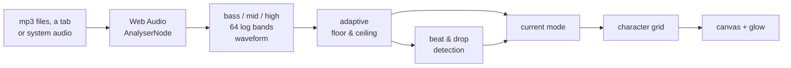

<div align="center">

```text
                              .,,,
                              +*+=
                             ,#*+:
                           .,**+-
                 .,;;;:,:=*###*=++-,,:;;;,.
              .;+#####*+=##%%#**##*-+####**=:
       .;=###*-#%%%%%##+;%%%%%%%###;*%%####*+-#***=:.
     .-##%%%##==%%%%%%%*:#%%%%%%%#*:*%%%%###-=%####*+;.
    :*%%%%%%%%*:#%%%%%%*:*%%%%%%%%+:#%%%%%#*:*%%%###**=,
   ;#%%%%%%%%%#:+@%%%%%%:+@@%%%%%%=;@%%%%%%=:%%%%%###*+=,
  :#%%%%@@@%%%%;-@+*%%%%:-@@@%%%%%-;@@%%*=%;;%%%%%%##**+=,
  *#%%%@@@@%%%%-::  -%%%:-@@@%%%%%;;@@%-  ,:-@%%%%%###*+=-
 ;#%%%%@@@@%%%%:     .+%:;@@%%%%%%:;@+.     :@%%%%%###*++-,
 +#%%%%%@@%%%*,        ::;%%%%%%%%:::        ,*%%%%##**++=:
 *#%%%%%%%%%;            ,%%%%%%%#,            ;#%###**+=-;
.*##%%%%%%%%%%%=:+%%%%%#::#%%**%#*:;%%%%%%=:+%%%%####**+=-;.
 *###%%%%%%%%%#=:+%%%%##::#%=  -#*::%%%%##=:+%%%####**++=-:
 +*####%%%%####=:+%%####::%-,,,,-#::%%%###=:=%#####***+=-;:
 ;**##### ,;=+#-:+######::########::######=:=#+=;, **++=-;,
 .+***###       .:--*#**::######**::###*-;:.       +++=-;:.
  :++****-.         ;***,  ,,,,,,  ,##*;         .;+==-;:,
   ;=+++***=:       ,;;-.          ,-;;,       :-+===-;::
    ;==++++++=:.                            .;=+===-;;:,
     ,;--===--;:+-:,       :----,       .:;-,;=---;;::,
       ,:;;;;;,-=====-:,.,,;====:...,;-=---;::;;;:::,
          .,,,.:;;;;;;;::--------;;,;;;;;;:::.,,,.
                .,,,:,,,,;;;;;;;:::,,,,:,,,.
                          .,,,,,,.
```

# NULL // SOUND

**A full-screen ASCII music visualizer for Halloween parties.**

Skulls, spiders and witches assemble from flying characters,<br>
pulse with the beat and blow apart when the drop hits.


[Quick start](#-quick-start) · [Modes](#-modes) · [Keys](#-keys) · [Settings](#-settings) · [How it works](#-how-it-works)

</div>

---

## ✨ Features

- 🎃 **Eight ASCII figures:** skull, spider, pumpkin, eye, ghost, tombstone, bat and a witch on a broom against the moon.
- 🥁 **Beat and drop detection:** every kick flashes and shakes the screen, and a drop blows the figure apart.
- 🔊 **Any sound source:** your own music files, a Chrome tab, or the whole system audio from Spotify / Apple Music apps.
- 🎚️ **Adapts to the track:** it learns what "quiet" and "loud" mean for the current music, so quiet and loud tracks both look alive.
- 🩸 **Huge words** like `TRICK OR TREAT` slam onto the screen every few bars, or type your own live.
- 📦 **Zero setup:** plain HTML, CSS and JavaScript. No server, no build, no dependencies. Double-click and go.

## 🚀 Quick start

```bash
git clone https://github.com/GrimVo1d/HalloweenMusicVisualizer.git
```

1. Open `index.html` in Chrome. A double-click is enough.
2. Pick a sound source:

   | Key | Source | Notes |
   |---|---|---|
   | `1` | **Music files** | Pick mp3 files or drop them into the window at any time. They play in a loop |
   | `2` | **Tab or screen** | Chrome only. Music in another tab: pick the **tab** and turn on **"Share tab audio"**. Music in an app (Spotify, Apple Music, …): pick **Entire screen** and turn on **"Share system audio"** |

3. Press `F` for fullscreen, put it on a big screen and turn the volume up.

> [!NOTE]
> **Music apps on macOS** need Chrome 141 or newer and macOS 14.2 or newer. The first time, macOS asks to allow Chrome in **System Settings → Privacy & Security → Screen & System Audio Recording**, then Chrome restarts. Only audio is used: the screen image is never looked at or sent anywhere.
>
> **Safari** can't share audio at all, so in Safari only music files work.

> [!TIP]
> Press `H` at any time to see every key.

## 👻 Modes

The modes rotate every `modeSeconds` seconds. `A` turns rotation off, `1`–`3` jump straight to a mode.

| # | Mode | What you see |
|---|---|---|
| 1 | **Spectrum** | An equalizer with a reflection: bass in the middle, highs at the edges |
| 2 | **Apparition** | A figure assembles from flying characters, sends out echo waves on beats, splits into red and purple fringes, tears with glitches. After `artBeats` beats it explodes and the next figure assembles from the shards |
| 3 | **NULL Scope** | An oscilloscope of the music with a trail |

On top of every mode:

- the screen flashes on each beat, brighter on harder hits;
- rows glitch and the screen jolts on strong kicks;
- the glow breathes with the loudness;
- every `wordEveryBeats` beats a huge word from `words` flashes on screen.

**The drop.** When a loud part kicks in after a quiet one, the screen bursts with digital noise, shakes hard, a word flashes and the figure explodes at once. At most once every 15 seconds.

<details>
<summary><b>🩸 Words: how they look</b></summary>

<br>

Every word is put together at random, and no part repeats the previous one:

- **font:** Impact or the horror font Creepster (non-Latin text always uses Impact);
- **entrance:** flash, slam with torn rows, decode left to right, top-to-bottom scan, falling columns;
- **exit:** fade, dissolve into characters, rows slide apart, letters melt down;
- **fill:** density characters, the text's own letters, running code, or an outline in another color;
- **color:** red, orange, green or purple.

</details>

<details>
<summary><b>💀 Locking one figure</b></summary>

<br>

`G` switches to Apparition and locks a figure. Each press takes the next one: cycle → skull → spider → … → witch → cycle again.

- A locked figure still moves with the music and explodes, but reassembles into itself. Rotation turns off so the figure holds the screen.
- Back on "cycle", rotation comes back as set in the config.
- The status line shows the choice: `fig: SPIDER` or `fig: cycle`.

</details>

<details>
<summary><b>⌨️ Your own text on screen</b></summary>

<br>

`T` opens a small gray line in the bottom-left corner with a character counter (up to `textLimit`). Type something like `HAPPY BIRTHDAY ALEX`, then:

- `Enter` shows it now in huge letters. Long text wraps into lines and stays longer;
- `Shift + Enter` shows it and adds it to the automatic words until the page is reloaded;
- `Esc` or `Enter` on an empty line closes the field.

If a figure is exploding or assembling at that moment, the text waits until it's done. While text is on screen, the figure does not explode, so the two never overlap.

While the field is open, other keys don't work. In fullscreen `Esc` also leaves fullscreen, so an empty `Enter` is the better way to close it.

</details>

## 🎹 Keys

| Key | Action | | Key | Action |
|---|---|---|---|---|
| `Space` / `→` | next mode | | `T` | type your own text |
| `←` | previous mode | | `G` | lock one figure |
| `1`–`3` | mode by number | | `↑` / `↓` | sensitivity |
| `A` | auto rotation on / off | | `N` | next track (files) |
| `W` | flash a word now | | `M` | back to the source picker |
| `F` | fullscreen | | `H` | help with all keys |

After any key a status line shows up in the bottom-left corner for a couple of seconds: mode, source, sensitivity, sound level.

## 🔧 Settings

Everything lives in [`config.js`](config.js). Change it, save, reload the page.

| Setting | Default | Meaning |
|---|---|---|
| `columns` | `150` | characters across the screen. If it lags, lower it to 100–120 |
| `modes` | `['bars', 'art', 'scope']` | modes and their order |
| `modeSeconds` | `30` | rotation interval in seconds (0 = keys only) |
| `sensitivity` | `1` | starting sensitivity, 0.2 to 1 |
| `words` | `HAPPY HALLOWEEN`, … | words that flash on screen |
| `wordEveryBeats` | `32` | flash a word every N beats (0 = `W` only) |
| `textLimit` | `40` | max length of your own text |
| `arts` | all eight | figures in Apparition and their order |
| `artBeats` | `16` | beats a figure holds before it explodes |
| `shakeOnBeat` | `true` | screen jolt on strong beats |

## 🧪 How it works



- **Sound.** An `AnalyserNode` (FFT size 2048) reads the spectrum and the waveform every frame. Tab and system audio come in through `getDisplayMedia`: only the audio track is analysed.
- **Adaptive loudness.** Each feature keeps its own running floor and ceiling, and the value is stretched between them. A quiet acoustic track and a loud club track both use the full range.
- **Beats.** Spectral flux of the bass (30–200 Hz): how sharply it grew since the last frame. A beat is a hit well above the usual spread over the last ~0.7 s.
- **Drops.** Short-term loudness (0.3 s) jumps well above long-term loudness (6 s).
- **Rendering.** Every mode writes brightness, color and an optional glyph into a character grid. Brightness maps to the density ramp ` .,:;-=+*#%@`. Each row is drawn in color layers: about 16 `fillText` calls per row instead of thousands of single characters per frame. A quarter-size blurred copy gives the glow.
- **Figures.** The ASCII art was generated from lit height maps, so the characters follow real light and shadow.

## 📁 Files

```
HalloweenMusicVisualizer/
├── index.html    the page
├── config.js     settings ← change things here
├── app.js        the visualizer
├── art.js        ASCII figures for Apparition
└── style.css
```

## 🩹 Troubleshooting

| Problem | Fix |
|---|---|
| Dropped files, but no sound | The browser blocks sound until the page is clicked: click or press any key |
| "No audio" after picking a tab | Pick a **tab** and turn on "Share tab audio", or **Entire screen** with "Share system audio". A single window never has audio |
| Music app is playing, but no reaction | Pick **Entire screen**, not the app's window. Check Chrome is 141+ and allowed in Screen & System Audio Recording |
| "Safari cannot share audio" | Safari doesn't support it. Open the page in Chrome, or play music files |
| A file says "can't play" | The browser doesn't support that format: convert it to mp3 |
| It lags | Lower `columns` in `config.js` |
| Headings in a plain font | No internet: the fonts load from Google Fonts. Everything else works |

<div align="center">
<br>

**Happy Halloween** 🎃

</div>
